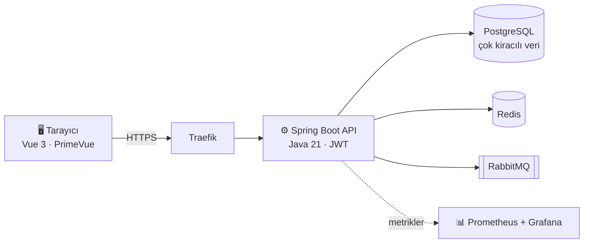

 

---

## Merhaba, ben Rasim 👋

Küçük bir işletmenin faturası, stoğu, cari hesapları ve günlük işleri çoğu zaman defterlerde, Excel dosyalarında ve birbirine bağlanmayan üç dört programda dağınık durur. Ben bunları tek ekranda toplayan yazılımlar geliştiriyorum.

Yazılımı kendi kendime öğrendim. Bugün **RasPel Co.**'nun kurucusuyum ve Türkiye'deki KOBİ'ler için kendi sunucusunda çalışan ERP ve finans ürünleri yapıyorum.

> 💡 **"KOBİ'nin Tek Panosu"**: işletmenin tamamı tek yerde.

| | |
|---|---|
| 🚀 **Şu an** | RasPel ERP'yi geliştiriyorum |
| 🧰 **Yığın** | Java 21 · Spring Boot · PostgreSQL · Vue 3 · Docker |
| 🎯 **Odak** | Çok kiracılı mimari, doğru finansal hesaplar, sorunsuz kurulum |

---

## 🚀 Projeler

<table>
<tr>
<td width="50%" valign="top">

### 🏢 RasPel ERP

KOBİ'ler için hepsi bir arada ön muhasebe ve işletme yönetimi platformu.

- Cari, fatura ve stok yönetimi
- Personel yönetimi
- Dahili sohbet ve ajanda
- Çok kiracılı mimari, Docker ile kurulum

[**Repoyu incele →**](https://github.com/Rasimtuzluoglu/raspel-erp)

</td>
<td width="50%" valign="top">

### 💳 RasPel Fin

Kredi kartı taksit takibi olarak başladı, bugün çok modüllü bir finansal yönetim platformu.

- Gider ve taksit takibi
- Departman bütçeleri
- Telegram bot ile hatırlatmalar
- Ortalama vade hesaplayıcı

[**Repoyu incele →**](https://github.com/Rasimtuzluoglu/raspel-fin)

</td>
</tr>
</table>

<b>🏗️ RasPel ERP mimarisine göz at</b>

 

Flyway ile sürümlenen veritabanı şeması, httpOnly çerezde JWT oturumu ve GitHub Actions üzerinde Trivy taramalı CI/CD hattı.

🔎 Ayrıca: [TheMoviA](https://github.com/Rasimtuzluoglu/TheMoviA) ve [diğer denemelerim](https://github.com/Rasimtuzluoglu?tab=repositories)

---

## 🧰 Araçlarım

---

## 🤝 İletişim

Küçük bir işletmeniz var ve programlar arasında kaybolmaktan yoruldunuz mu? Benzer bir ürün üzerinde çalışıyorsunuz ya da Java backend arayan bir ekipsiniz? Yazın, konuşalım.

