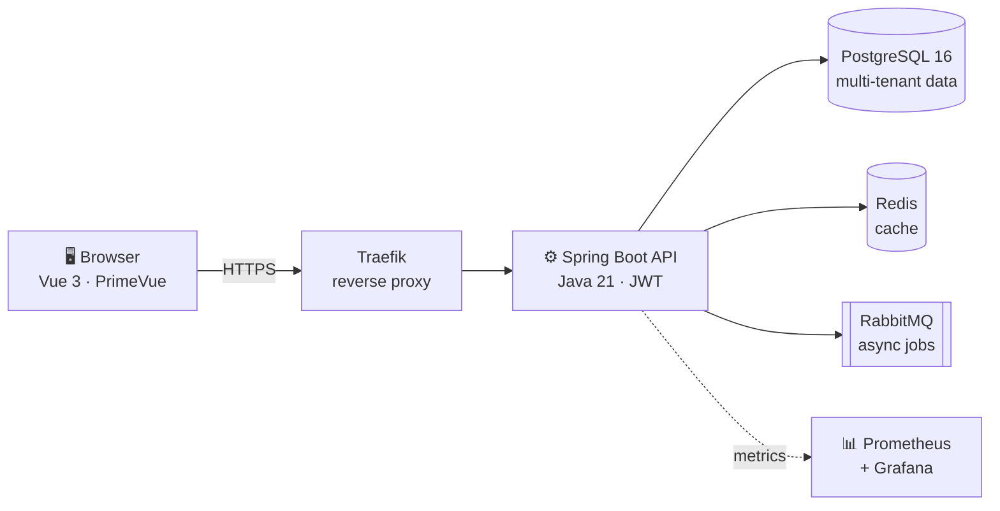

 

---

## 👋 Hi, I'm Rasim

I build the unglamorous software that keeps small businesses running: invoices, stock, receivables, payroll, the daily paperwork that usually lives in five different programs and three notebooks.

I'm a self-taught backend developer and the founder of **RasPel Co.**, where I'm building on-premise business software for Turkish SMBs (KOBİ). My bet is simple: a small business shouldn't need to juggle tools. **One dashboard, one source of truth.**

> 💡 *"KOBİ'nin Tek Panosu"*: one board for the whole business.

|  |  |
|---|---|
| 🚀 **Building now** | **RasPel ERP**, an all-in-one business management platform |
| 🧠 **Obsessed with** | Multi-tenant architecture, financial accuracy, clean data models |
| 🛠️ **Daily stack** | Java 21 · Spring Boot · PostgreSQL · Vue 3 · Docker |
| 🌱 **Leveling up** | Testing, security hardening, observability, deployment pipelines |
| 🎯 **Goal** | Ship software that a real shop owner opens every morning |

---

## 🚀 Featured Projects

### 🏢 RasPel ERP &nbsp; 

> An all-in-one, Docker-based ERP for small and medium-sized businesses, built so owners never have to leave it for another program.

<table>
<tr>
<td width="50%" valign="top">

**What it covers**
- 💰 Pre-accounting, invoicing and finance
- 📦 Inventory and product catalog
- 👥 Workforce management
- 💬 Built-in team chat
- 📅 Agenda with tasks and reminders
- 🔄 Business workflows

</td>
<td width="50%" valign="top">

**How it's built**
- 🏗️ Multi-tenant architecture
- 🔐 JWT in httpOnly cookies
- 🗄️ Flyway-managed schema migrations
- 🐳 Docker + Traefik deployment
- 📈 Prometheus & Grafana monitoring
- 🛡️ GitHub Actions CI/CD with Trivy scans

</td>
</tr>
</table>

**Stack:** Java 21 · Spring Boot 3 · Vue 3 · PrimeVue · Tailwind CSS · PostgreSQL · Redis · RabbitMQ · Flyway · Docker

[**Explore the repository →**](https://github.com/Rasimtuzluoglu/raspel-erp)

---

### 💳 RasPel Fin &nbsp; 

> Started as a credit card installment tracker, grew into a multi-module financial management platform.

- 🧾 Expense management and credit card installment tracking
- 🏷️ Department budgets with direct cost deduction
- ⏰ Financial reminders, delivered through a **Telegram bot** (secure token-based linking, HMAC-SHA256 verification)
- 📐 Weighted average due date (*ortalama vade*) calculator with CSV import
- 👤 Multi-user support, with Excel and PDF exports

**Stack:** Java 21 · Spring Boot 3.4 · Vaadin 24 · PostgreSQL · Flyway · Spring Security

[**Explore the repository →**](https://github.com/Rasimtuzluoglu/raspel-fin)

---

### 🎬 TheMoviA

A side project where I experiment with application development outside of the business-software world.

[**Explore the repository →**](https://github.com/Rasimtuzluoglu/TheMoviA)

&nbsp;&nbsp;🔎 *More experiments live in [all my repositories](https://github.com/Rasimtuzluoglu?tab=repositories).*

---

## 🧭 What I Care About When Building

| Principle | In practice |
|---|---|
| **Correctness first** | Money and dates are where ERP bugs hurt most, so I treat tax (KDV) and date calculations as critical paths. |
| **Tenant isolation** | One customer must never see another's data. I design for this from the first migration. |
| **Boring, reliable ops** | Versioned migrations, containerized deploys, automated scans, dashboards that tell me what's wrong before users do. |
| **Software owners can use** | If a shop owner needs a manual to issue an invoice, the design has failed. |

---

## 🗺️ What's Next

- [x] Core ERP modules: finance, inventory, workforce
- [x] Containerized deployment with CI/CD and monitoring
- [ ] 🚚 Delivery & dispatch tracking for sales and invoices
- [ ] 💬 Group chat rooms for teams
- [ ] 📅 Tasks and reminders inside the agenda module
- [ ] 📊 A more corporate dashboard with richer charts
- [ ] 🤖 An AI assistant layer on top of business data

---

## 🧰 Tech Toolbox

**Backend**

**Frontend**

**Data & Messaging**

**DevOps & Tooling**

---

## 📊 GitHub Activity

---

## 🤝 Let's Talk

Running a small business and tired of juggling programs? Building something similar and want to compare notes? Hiring for a Java backend role? I'd like to hear from you.

Building, learning, and improving, one commit at a time.

